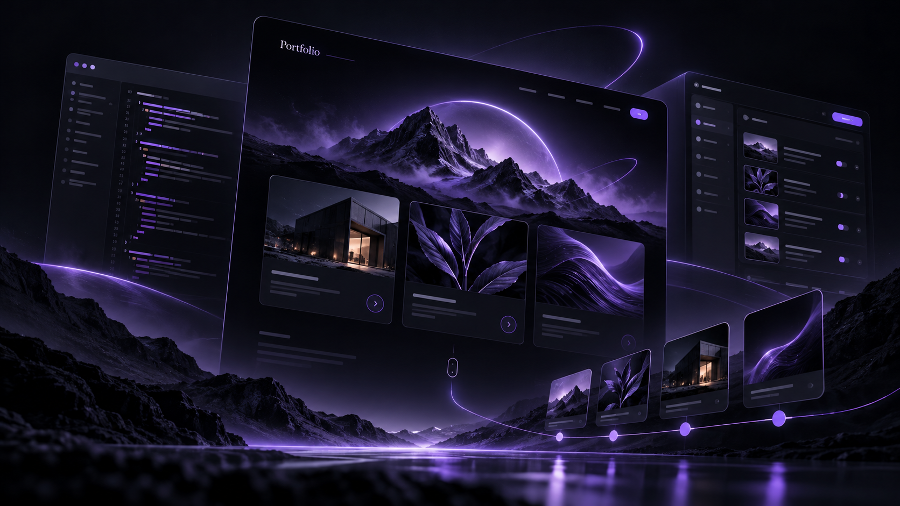

# Portfolio

A cinematic, data-driven portfolio for projects, experience, education, and technical work.

The site pairs a scroll-driven public experience with a self-built content management backend, so projects, certifications, and contact links can be updated without editing the frontend source.

## Highlights

- Three visual modes: cinematic, Iron Man-inspired HUD, and print-style resume
- Responsive GSAP-powered motion and scroll interactions
- Single-admin CMS with bcrypt authentication and session cookies
- Dockerized Node.js and Express deployment behind nginx

**Live site:** [sudheerkumargandiboyana.com](https://sudheerkumargandiboyana.com/)
